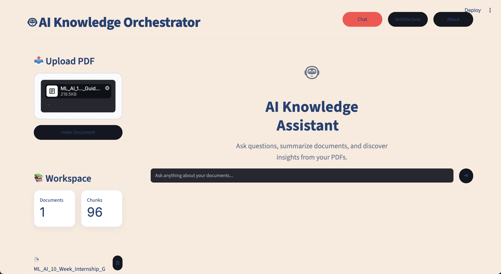
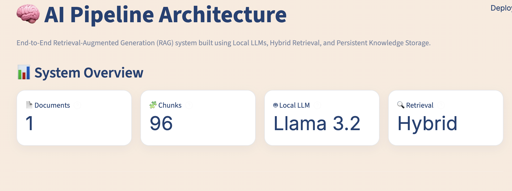
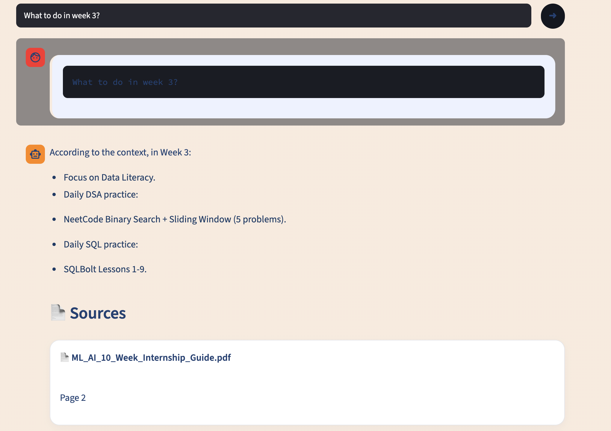
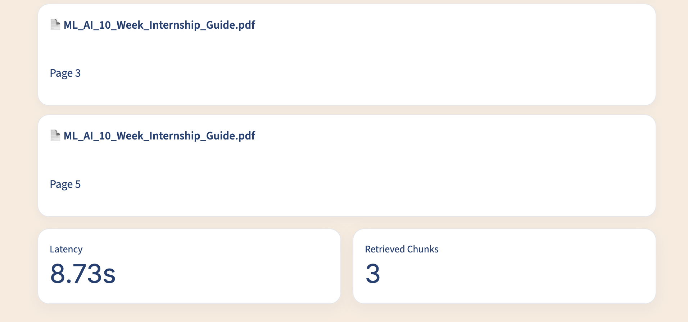
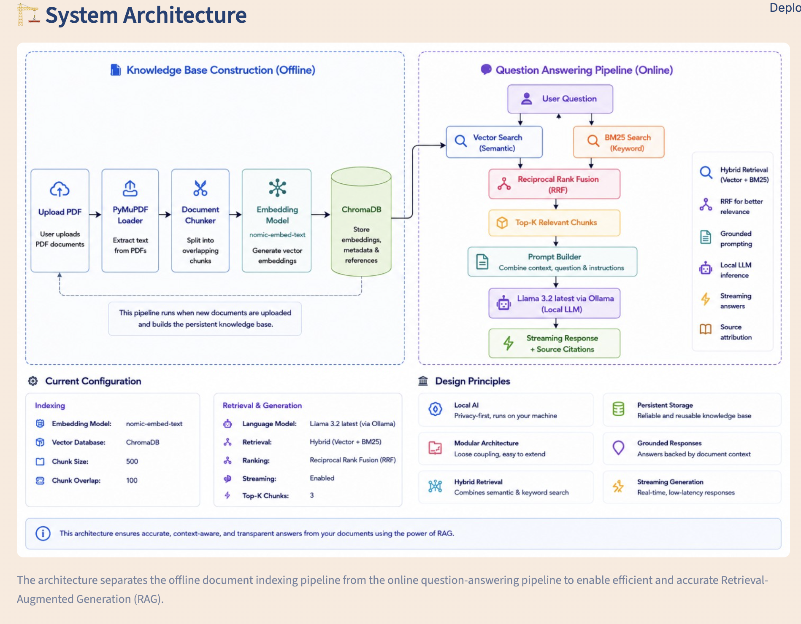
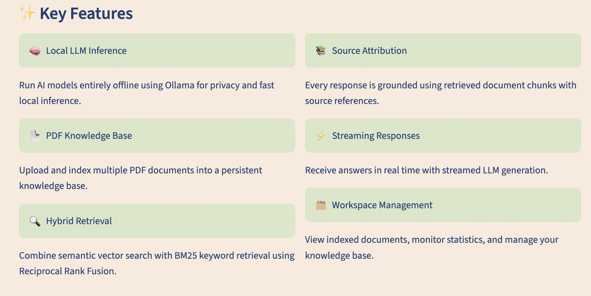
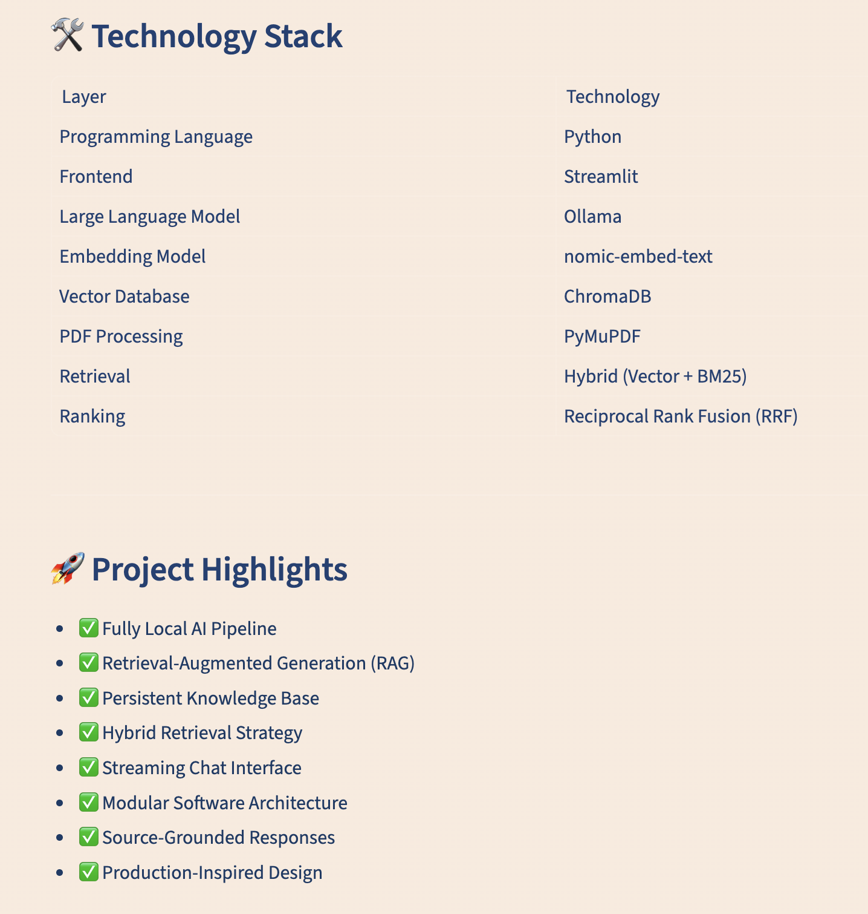

# 🤖 AI Knowledge Assistant

<p align="center">
  <strong>An intelligent Retrieval-Augmented Generation (RAG) system that enables conversational interaction with your documents using Hybrid Retrieval, Claude, and a modern Streamlit interface.</strong>
</p>

<p align="center">

<!-- Badges (We'll add these later) -->

Python • Streamlit • Claude • ChromaDB • Hybrid Retrieval • BM25 • RAG

</p>

---

## 📸 Application Preview

<p align="center">



</p>

---

# 📖 Overview

AI Knowledge Orchestrator is a Retrieval-Augmented Generation (RAG) application that turns PDF, Word, text and Markdown documents into an interactive knowledge base.

Instead of relying solely on semantic vector search, the application combines dense retrieval from ChromaDB with lexical retrieval using BM25. The retrieved results are fused using Reciprocal Rank Fusion (RRF), providing more accurate and context-aware responses.

Search runs inside the app with a small embedding model, and answers come from Claude through the Anthropic API. An Anthropic API key is the only thing you need to configure.

---

# ✨ Features

### 📄 Document Processing

- Upload PDF documents through a clean workspace interface
- Automatic text extraction using PyMuPDF
- Intelligent document chunking
- Persistent knowledge base

---

### 🔍 Hybrid Retrieval

- Semantic Vector Search
- BM25 Keyword Search
- Reciprocal Rank Fusion (RRF)
- Context-aware document retrieval

---

### 🤖 Claude

- Answers from Claude Opus 5.5, Sonnet 5.5 or Haiku 5.5
- Numbered citations to the source passages
- Fully offline execution
- Streaming response generation

---

### 📚 Explainable Responses

- Source attribution
- Retrieved page references
- Latency statistics
- Retrieved chunk count

---

### 🎨 Modern User Interface

- Responsive Streamlit interface
- Workspace management
- AI pipeline visualization
- Interactive architecture explorer

---

# 🎥 Demo

> *https://ai-knowledge-orchestrator.streamlit.app/*

---

# 🏗️ System Architecture



The application follows a modular Retrieval-Augmented Generation pipeline consisting of document ingestion, semantic indexing, hybrid retrieval, prompt construction, and local language model inference.

---

# ⚙️ Pipeline Workflow

```text
                    PDF Documents
                           │
                           ▼
                  Document Loader
                           │
                           ▼
                 Text Chunking Pipeline
                           │
            ┌──────────────┴──────────────┐
            ▼                             ▼
      Embedding Model                BM25 Index
            │                             │
            ▼                             ▼
        ChromaDB                  Lexical Retrieval
            └──────────────┬──────────────┘
                           ▼
             Reciprocal Rank Fusion
                           ▼
                 Context Construction
                           ▼
                Claude (Anthropic API)
                           ▼
                Streaming Response
```

---

# 🛠️ Technology Stack

| Category | Technology |
|-----------|------------|
| Programming Language | Python |
| Frontend | Streamlit |
| Language Model | Claude (Anthropic API) |
| Embedding Model | all-MiniLM-L6-v2 (in-app, ONNX Runtime) |
| Vector Database | ChromaDB |
| PDF Processing | PyMuPDF |
| Retrieval | Hybrid (Vector + BM25) |
| Ranking | Reciprocal Rank Fusion (RRF) |

---

# 📂 Project Structure

```text
AI-Knowledge-Orchestrator/
│
├── app/
│   ├── core/
│   ├── embeddings/
│   ├── indexing/
│   ├── ingestion/
│   ├── llm/
│   ├── retrieval/
│   ├── services/
│   ├── utils/
│   └── vectorstore/
│
├── components/
│   ├── assets/
│   ├── chat/
│   ├── layout/
│   ├── pages/
│   └── sidebar/
│
├── data/
├── evals/
├── tests/
├── app.py
├── requirements.txt
└── README.md
```

---

# 🚀 Installation

```bash
git clone https://github.com/<YOUR_USERNAME>/AI-Knowledge-Orchestrator.git

cd AI-Knowledge-Orchestrator

python -m venv .venv

source .venv/bin/activate

pip install -r requirements.txt

cp .env.example .env   # then add your ANTHROPIC_API_KEY

streamlit run app.py
```

## Configuration

Settings are read from environment variables, or from a `.env` file
in the project root (copy `.env.example` to `.env`).

| Variable | Meaning |
| --- | --- |
| `ANTHROPIC_API_KEY` | Required to answer questions. Documents can be uploaded and indexed without it. |

On Streamlit Community Cloud, add the key under the app's
**Settings → Secrets**:

```toml
ANTHROPIC_API_KEY = "sk-ant-..."
```

The embedding model (about 80 MB) downloads on first use and then
runs inside the app, so there is nothing else to install.

## Tests and evaluation

```bash
pip install -r requirements-dev.txt

pytest
```

The tests run offline. To measure retrieval quality on your own
documents, list questions and the pages that answer them in
`evals/questions.json`, then run:

```bash
python -m evals.retrieval_eval
```

---

# 💬 Usage

1. Upload one or more documents (PDF, Word `.docx`, `.txt` or `.md`).
2. Index the uploaded knowledge base.
3. Ask questions in natural language.
4. The application retrieves relevant document chunks using Hybrid Retrieval.
5. Retrieved context is sent to the local LLM.
6. Receive grounded responses with source attribution.

---

# 🖼️ Screenshots

## Home


---

## Chat Interface



---

## Source Attribution



---

## Architecture



---

## Technology Overview




---

# 🚀 Future Improvements

- OCR support for scanned PDFs
- Multi-document collections
- Citation highlighting
- Conversation memory
- Cloud deployment
- Authentication
- Multi-user workspaces
- Additional LLM providers

---

# 📄 License

This project is licensed under the MIT License.

---

# 👨‍💻 Author

**Rishi Shah**

If you found this project helpful, feel free to ⭐ the repository.
